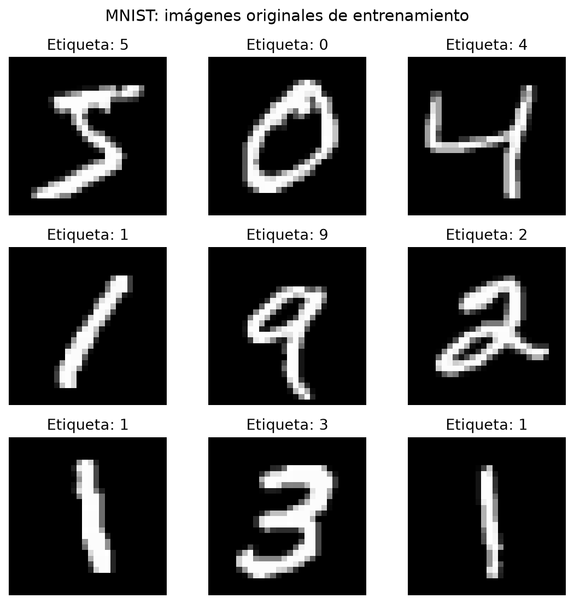
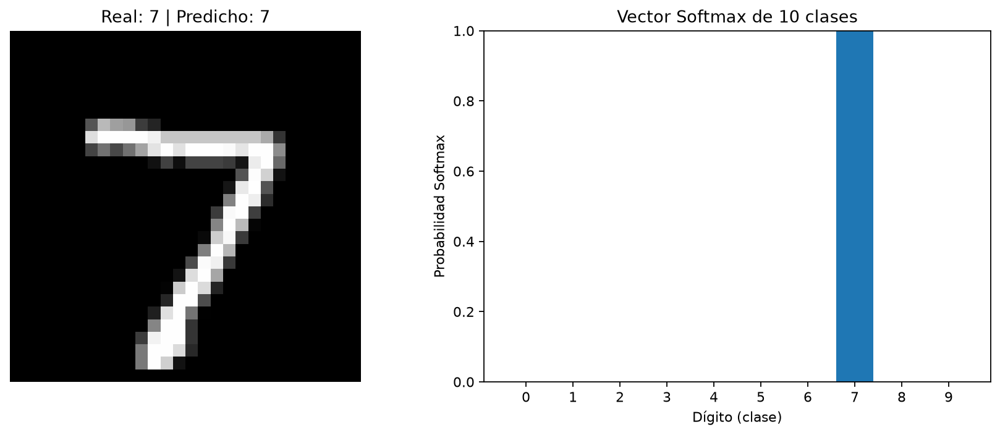
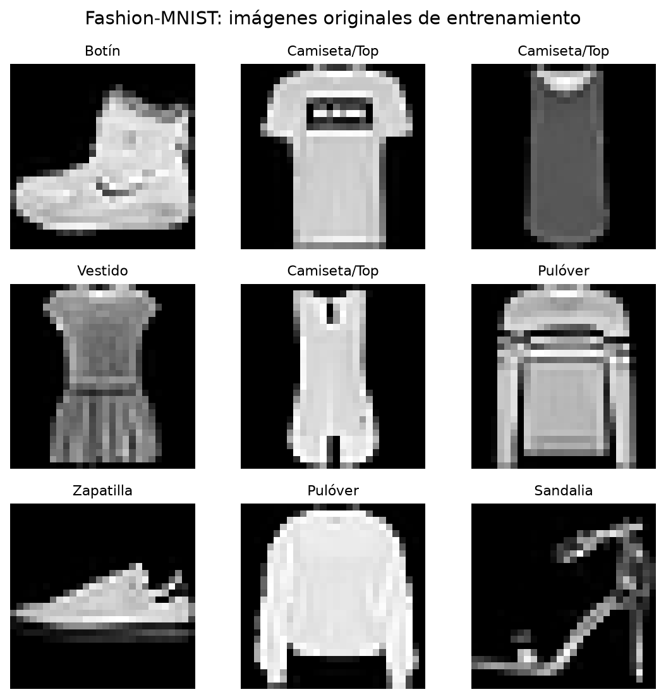
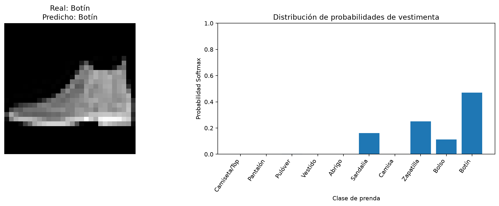
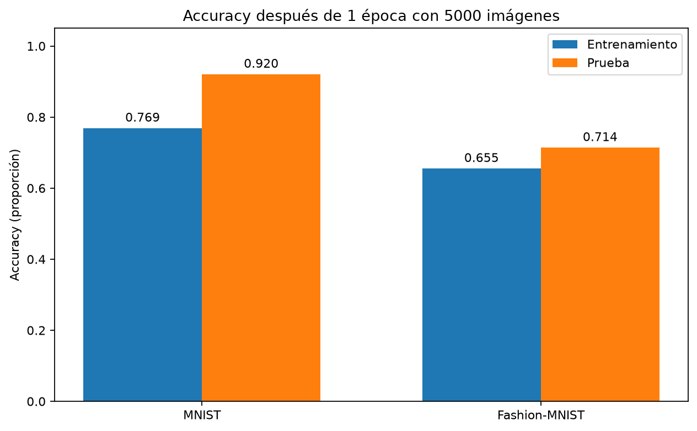
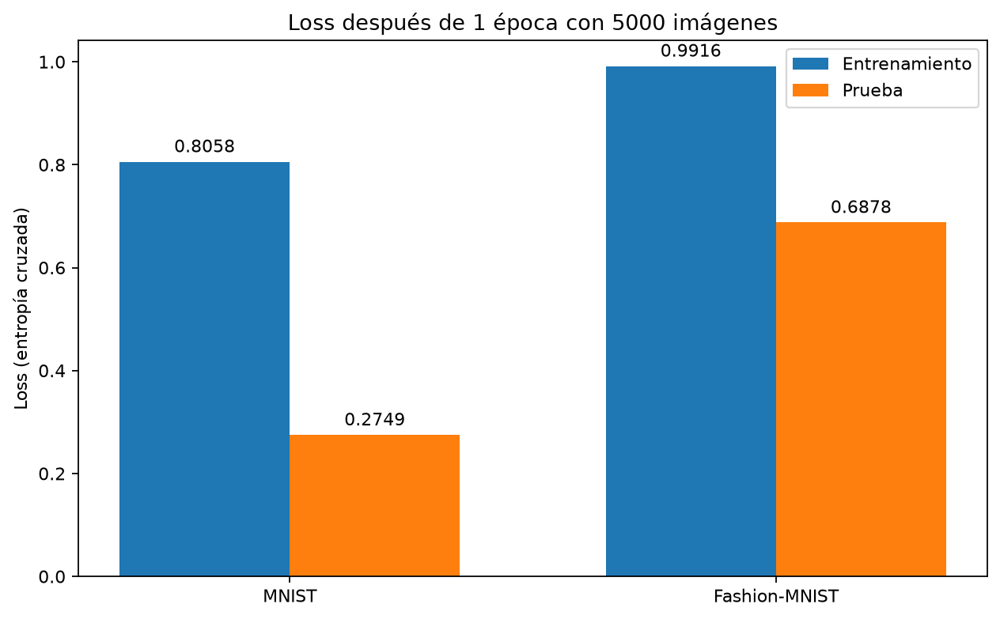

# Guía de Laboratorio 05 — Arquitecturas CNN: MNIST vs. Fashion-MNIST
> **Curso:** SIS070 — Inteligencia Artificial

  **Estudiantes:**  Peña Salgueron Jerson Americo - Ramos Cruz Zidane Giovanni

> **Unidad:** II — Redes Neuronales Convolucionales

> **Escuela:** Ingeniería de Sistemas — Universidad Andina del Cusco

> **Entorno:** Visual Studio Code · Python 3.11.9 · TensorFlow 2.19.1 · Keras · NumPy · Matplotlib

> **Tipo de entrega:** Implementación, visualización, interpretación de resultados y comparación crítica.

## 1. Introducción, objetivos y resumen del experimento
En esta práctica se implementaron y ejecutaron **dos redes neuronales convolucionales (CNN)** para resolver problemas de clasificación de imágenes: reconocimiento de números manuscritos con **MNIST** y reconocimiento de prendas con **Fashion-MNIST**. Además de entrenar y predecir, se estudiaron las imágenes originales, las dimensiones de cada tensor, el número de parámetros entrenables, el funcionamiento de la salida Softmax y las diferencias entre los resultados de ambos modelos.

**Objetivos cumplidos:** visualizar los datos originales; implementar las arquitecturas solicitadas; explicar `model.summary()`; calcular matemáticamente los parámetros; interpretar vectores Softmax y `np.argmax()`; contrastar las métricas obtenidas en una época; organizar evidencias y archivos para su publicación en GitHub.

**Resultado principal:** MNIST consiguió **76.88 % de accuracy de entrenamiento** y **92.04 % de prueba**; Fashion-MNIST obtuvo **65.50 % de entrenamiento** y **71.38 % de prueba**. Ambos modelos acertaron su primera imagen de prueba, pero la distribución Softmax fue mucho más concentrada en MNIST (99.9365 % para el dígito 7) que en Fashion-MNIST (46.9306 % para la categoría Botín). Son **resultados de esta ejecución específica**, no valores universales de los datasets.

## 2. Diseño del experimento y preparación de los datos
| Aspecto | MNIST | Fashion-MNIST |

|---|---|---|

| Problema | Reconocer dígitos del 0 al 9 | Clasificar 10 clases de vestimenta |

| Datos disponibles de entrenamiento | 60,000 imágenes | 60,000 imágenes |

| Datos de prueba | 10,000 imágenes | 10,000 imágenes |

| Imágenes usadas para entrenar | **5,000** (primeras del conjunto) | **5,000** (primeras del conjunto) |

| Tamaño de cada imagen | 28 × 28 píxeles | 28 × 28 píxeles |

| Canales | 1 (escala de grises) | 1 (escala de grises) |

| Épocas | **1** | **1** |

| Tamaño del lote (`batch_size`) | **64** | **64** |

| Optimizador | Adam | Adam |

| Función de pérdida | `sparse_categorical_crossentropy` | `sparse_categorical_crossentropy` |

| Capa densa oculta | 64 neuronas | 128 neuronas |

| Salida | 10 neuronas, activación Softmax | 10 neuronas, activación Softmax |

El entrenamiento respetó las condiciones de la guía: **5,000 ejemplos, una época y lote de 64**. Como complemento, los programas evaluaron el desempeño con las **10,000 imágenes del conjunto de prueba**, diferentes de las utilizadas para ajustar los pesos.

**Preprocesamiento aplicado:**

```python

X_train = X_train.astype("float32") / 255.0

X_train = np.expand_dims(X_train, axis=-1)

X_test = X_test.astype("float32") / 255.0

X_test = np.expand_dims(X_test, axis=-1)

```

Los valores originales de píxel están entre **0 y 255**. Al dividirlos entre 255 se normalizan al intervalo **[0, 1]**, lo que ayuda a trabajar con una escala homogénea. `np.expand_dims(..., -1)` agrega el eje del canal de color: `X_train.shape` pasa de **`(60000, 28, 28)`** a **`(60000, 28, 28, 1)`**. El número inicial representa la cantidad de imágenes; los tres restantes indican alto, ancho y canales. En `model.summary()`, `None` significa que el tamaño de lote no está fijado en el modelo.

## 3. Parte 1 — Análisis de MNIST
### 3.1. Inspección visual de las imágenes originales
La siguiente figura muestra las nueve primeras imágenes de entrenamiento, en una cuadrícula de **3 × 3**. Se observan los dígitos **5, 0, 4, 1, 9, 2, 1, 3 y 1**, con trazos claros sobre fondo oscuro. Cada imagen está etiquetada con su clase real.



**Figura 1. Evidencia generada por `mnist_cnn.py`: nueve dígitos manuscritos del conjunto de entrenamiento.**

**Interpretación:** los números no tienen una tipografía uniforme. Algunos trazos son inclinados, más gruesos o menos regulares. Inspeccionar las imágenes antes de entrenar permite comprobar visualmente qué características tendrá que aprender la red, verificar la correspondencia entre imagen y etiqueta y reconocer patrones como bordes, líneas y curvas. Aunque los dígitos pueden confundirse cuando la escritura es ambigua, el conjunto observado contiene trazos relativamente simples y aislados.

### 3.2. Predicción y vector Softmax de MNIST
Después del entrenamiento, el modelo evaluó la **primera imagen de prueba**: un dígito **7**. La predicción también fue **7**, por lo que acertó en esta muestra.



**Figura 2. Imagen de prueba (izquierda) y distribución Softmax entre los dígitos 0 a 9 (derecha).**

**Vector presentado en consola (seis decimales):**

```text

[0.000001 0.000001 0.000107 0.000050 0.000000

 0.000054 0.000000 0.999365 0.000013 0.000409]

```

| Clase | Probabilidad | Lectura |

|---:|---:|---|

| 0 | 0.000001 | Muy baja |

| 1 | 0.000001 | Muy baja |

| 2 | 0.000107 | Muy baja |

| 3 | 0.000050 | Muy baja |

| 4 | 0.000000 | Redondeada a 0 en la salida mostrada |

| 5 | 0.000054 | Muy baja |

| 6 | 0.000000 | Redondeada a 0 en la salida mostrada |

| **7** | **0.999365** | **Máxima: 99.9365 %** |

| 8 | 0.000013 | Muy baja |

| 9 | 0.000409 | Segunda mayor: 0.0409 % |

La función **Softmax** convierte las puntuaciones de salida en diez valores no negativos cuya suma teórica es **1**. La terminal mostró la suma **`1.00000012`**; la pequeña diferencia respecto de 1 se debe a la precisión numérica de los cálculos. Los diez números visibles en la tabla están redondeados a seis decimales y no son los valores internos exactos de precisión completa.

La expresión `np.argmax(predicciones[0])` localiza **el índice del valor máximo**, que en este caso es **7**, no el valor `0.999365` en sí. Finalmente, `y_test[0]` es **7**, de modo que `clase_predicha == clase_real` es verdadero. El modelo asignó un 99.9365 % de probabilidad Softmax al dígito 7; **este porcentaje describe la salida de la red para una imagen, no la precisión global ni una garantía de corrección**.

## 4. Arquitectura CNN — Interpretación profunda de `model.summary()`
Las redes mantienen la misma **parte convolucional**; la principal diferencia arquitectónica es el tamaño de la capa densa oculta: **64** neuronas en MNIST y **128** en Fashion-MNIST.

### 4.1. Capas, tensores de salida y parámetros observados
| Capa de `model.summary()` | `Output Shape` MNIST | Parámetros MNIST | `Output Shape` Fashion-MNIST | Parámetros Fashion |

|---|---|---:|---|---:|

| Entrada | `(None, 28, 28, 1)` | 0 | `(None, 28, 28, 1)` | 0 |

| `Conv_1 (Conv2D)` | `(None, 26, 26, 32)` | 320 | `(None, 26, 26, 32)` | 320 |

| `MaxPool_1 (MaxPooling2D)` | `(None, 13, 13, 32)` | 0 | `(None, 13, 13, 32)` | 0 |

| `Conv_2 (Conv2D)` | `(None, 11, 11, 64)` | 18,496 | `(None, 11, 11, 64)` | 18,496 |

| `MaxPool_2 (MaxPooling2D)` | `(None, 5, 5, 64)` | 0 | `(None, 5, 5, 64)` | 0 |

| `Aplanado_Flatten (Flatten)` | `(None, 1600)` | 0 | `(None, 1600)` | 0 |

| `Capa_Densa_Oculta (Dense)` | `(None, 64)` | 102,464 | `(None, 128)` | 204,928 |

| `Salida_Softmax (Dense)` | `(None, 10)` | 650 | `(None, 10)` | 1,290 |

| **Total de parámetros entrenables** | — | **121,930** | — | **225,034** |

Ambos resúmenes informaron **0 parámetros no entrenables**. Las dimensiones y cantidades mostradas corresponden a los resúmenes reales que imprimió TensorFlow.

### 4.2. ¿Por qué `Conv_1` pasa de 28 × 28 a 26 × 26?
Una convolución sin relleno (`padding='valid'`), con paso (`stride`) de 1 y kernel de **3 × 3**, produce una dimensión espacial calculada con:

$$

\text{salida}=\frac{\text{entrada}-\text{kernel}}{\text{stride}}+1

$$

Por lo tanto, **28 − 3 + 1 = 26**. La primera capa genera **32 mapas de características** porque dispone de 32 filtros: `(26, 26, 32)`. `MaxPool_1`, con ventana **2 × 2** y paso 2, selecciona el máximo de cada región y reduce las dimensiones a **13 × 13**, manteniendo 32 canales. No tiene pesos entrenables.

La segunda convolución vuelve a aplicar un kernel 3 × 3 sin padding: **13 − 3 + 1 = 11**, y produce 64 canales. `MaxPool_2` reduce **11 × 11** a **5 × 5** (descarta la posición espacial sobrante cuando corresponde por el tamaño impar). Por eso la entrada de Flatten es **5 × 5 × 64**.

### 4.3. Cálculo matemático de parámetros entrenables
En `Conv2D`, cada filtro posee un peso por cada posición del kernel y canal de entrada, además de un sesgo (`bias`):

$$

\text{parámetros Conv2D}=(k_h\times k_w\times C_{in}+1)\times C_{out}

$$

- **`Conv_1`:** `(3 × 3 × 1 + 1) × 32 = 320` parámetros.

- **`Conv_2`:** `(3 × 3 × 32 + 1) × 64 = (288 + 1) × 64 = 18,496` parámetros. Cada uno de los 64 filtros tiene **288 pesos y 1 bias**.

- **`Flatten`:** `5 × 5 × 64 = 1,600` valores por imagen, **0 parámetros**. Su función es reorganizar los mapas de características como vector para conectarlos con la capa densa; no aprende pesos.

- **`Dense(64)` — MNIST:** `(1600 + 1) × 64 = 102,464` parámetros.

- **`Dense(10)` — MNIST:** `(64 + 1) × 10 = 650` parámetros.

**Total MNIST:** `320 + 18,496 + 102,464 + 650 = 121,930`.

Para **Fashion-MNIST**, los parámetros convolucionales permanecen iguales, pero:

- **`Dense(128)`:** `(1600 + 1) × 128 = 204,928` parámetros.

- **`Dense(10)`:** `(128 + 1) × 10 = 1,290` parámetros.

**Total Fashion-MNIST:** `320 + 18,496 + 204,928 + 1,290 = 225,034`.

La red Fashion-MNIST tiene **103,104 parámetros adicionales**, un incremento de **84.56 %** respecto de MNIST. Este aumento le proporciona mayor capacidad para combinar características, pero también supone más pesos que ajustar con los mismos 5,000 ejemplos. **No garantiza automáticamente mejores resultados**, y es importante tenerlo en cuenta al comparar los experimentos.

## 5. Parte 2 — Análisis de Fashion-MNIST
### 5.1. Inspección visual y complejidad de las prendas
En Fashion-MNIST, las imágenes ya no son trazos numéricos: representan **siluetas completas de prendas**, con superficies rellenas, bordes, variaciones de forma y algunas zonas sombreadas. En la figura se aprecian ejemplos de botín, camiseta/top, vestido, pulóver, zapatilla y sandalia.



**Figura 3. Evidencia generada por `fashion_cnn.py`: nueve prendas de entrenamiento con sus etiquetas nominales.**

**Análisis visual:** al compartir la misma resolución de 28 × 28 píxeles, categorías parecidas pueden perder detalles distintivos: camisa, camiseta, abrigo y pulóver suelen compartir contornos; zapatillas y botines presentan rasgos estructurales semejantes. A diferencia de los trazos relativamente sencillos de MNIST, reconocer estas prendas requiere distinguir más combinaciones de silueta, proporción y textura. Eso **puede** aumentar la incertidumbre de clasificación, aunque no significa que todas las prendas sean siempre más difíciles que todos los dígitos.

### 5.2. Conversión de índices a clases nominales con `class_names`
La red entrega diez probabilidades asociadas a los índices `0` a `9`. El arreglo `class_names` convierte esos índices abstractos en categorías comprensibles:

| Índice | Categoría | Índice | Categoría |

|---:|---|---:|---|

| 0 | Camiseta/Top | 5 | Sandalia |

| 1 | Pantalón | 6 | Camisa |

| 2 | Pulóver | 7 | Zapatilla |

| 3 | Vestido | 8 | Bolso |

| 4 | Abrigo | 9 | Botín |

Por ejemplo, `np.argmax(vector)` devolvió **9** y `class_names[9]` lo tradujo a **«Botín»**. La conversión hace que el resultado sea interpretable, pero **no cambia el aprendizaje ni las probabilidades**.

### 5.3. Predicción de Botín y análisis del vector Softmax
La primera imagen de prueba corresponde a **Botín (índice 9)** y el modelo también predijo **Botín (índice 9)**. Por lo tanto, la predicción fue correcta, aunque su confianza se repartió entre varias clases.



**Figura 4. Prenda de prueba (izquierda) y distribución Softmax de diez categorías (derecha).**

**Vector presentado en consola (seis decimales):**

```text

[0.000404 0.000028 0.002558 0.000205 0.000322

 0.161574 0.001784 0.251244 0.112575 0.469306]

```

| Índice | Etiqueta | Probabilidad | Interpretación |

|---:|---|---:|---|

| 0 | Camiseta/Top | 0.000404 | Muy baja |

| 1 | Pantalón | 0.000028 | Muy baja |

| 2 | Pulóver | 0.002558 | Baja |

| 3 | Vestido | 0.000205 | Muy baja |

| 4 | Abrigo | 0.000322 | Muy baja |

| 5 | Sandalia | 0.161574 | **16.1574 %** |

| 6 | Camisa | 0.001784 | Baja |

| 7 | Zapatilla | 0.251244 | **25.1244 %** |

| 8 | Bolso | 0.112575 | **11.2575 %** |

| **9** | **Botín** | **0.469306** | **Máxima: 46.9306 %** |

En consola, la suma del vector sin el redondeo de visualización fue **`1.00000012`**, aproximadamente 1. `np.argmax()` eligió la clase 9 porque `0.469306` es el mayor valor, pese a que también asignó probabilidades importantes a Zapatilla y Sandalia. Esto sugiere **incertidumbre entre categorías** en esta muestra. El porcentaje de 46.9306 % es confianza **Softmax de esa imagen**, no accuracy del conjunto completo.

### 5.4. Impacto de la capa densa de 128 neuronas
El paso de 64 a **128 neuronas** aumenta los pesos de la etapa clasificadora y permite representar más combinaciones de las características extraídas por las convoluciones. Esta decisión puede resultar útil para categorías visualmente similares, pero después de **solo una época y 5,000 imágenes** el modelo todavía exhibe una distribución de probabilidades dispersa en la muestra estudiada. Aumentar neuronas implica también mayor costo y posible sobreajuste; **no hay evidencia aquí para afirmar que el tamaño de la capa densa sea la causa directa** de la diferencia de rendimiento, porque se compararon simultáneamente datasets distintos.

## 6. Parte 3 — Comparación crítica de ambos modelos
### 6.1. Comparación cuantitativa de entrenamiento y prueba
| Indicador observado | MNIST | Fashion-MNIST | Lectura comparativa |

|---|---:|---:|---|

| Accuracy de entrenamiento | **76.88 %** | 65.50 % | MNIST supera por **11.38 puntos porcentuales** |

| Loss de entrenamiento | **0.805811** | 0.991609 | MNIST tiene **menor pérdida** |

| Accuracy de prueba | **92.04 %** | 71.38 % | MNIST supera por **20.66 puntos porcentuales** |

| Loss de prueba | **0.274901** | 0.687821 | MNIST tiene **menor pérdida** |

| Parámetros entrenables | 121,930 | 225,034 | Fashion-MNIST tiene **84.56 % más parámetros** |

| Clase predicha de la primera imagen | 7 | Botín | **Ambas predicciones acertaron** |

| Probabilidad Softmax máxima | **99.9365 %** | 46.9306 % | Mayor concentración en **la muestra MNIST** |



**Figura 5. Exactitud observada de ambos modelos después de una época.**



**Figura 6. Pérdida de entropía cruzada categórica dispersa de ambos modelos.**

**Interpretación de accuracy:** es la fracción de ejemplos clasificados correctamente. En esta ejecución MNIST logró mejores valores tanto durante el entrenamiento como al evaluar las imágenes no usadas para entrenar. **Interpretación de loss:** es una medida del desacuerdo entre la distribución predicha y la clase verdadera; menor loss suele ser favorable, pero no equivale directamente a un porcentaje de error. La pérdida fue menor para MNIST en ambos conjuntos.

**¿Cuál aprendió de manera más eficiente en esta práctica?** Bajo la configuración solicitada de **una sola época**, MNIST alcanzó una exactitud mayor con menos parámetros, por lo que mostró **mejor desempeño observado al finalizar el entrenamiento**. Sin embargo, no corresponde afirmar que «converge más rápido» en general: para comparar realmente la velocidad de aprendizaje harían falta varias épocas, curvas de aprendizaje y, preferentemente, repeticiones controladas.

### 6.2. Contraste entre complejidad visual y predicciones
**MNIST:** las imágenes presentan trazos numéricos de grosor y orientación variables, normalmente separados del fondo. La red puede aprovechar contornos y combinaciones de líneas relativamente distintivas. Para la primera imagen de prueba, su salida se concentra casi por completo en el **7 (99.9365 %)** y descarta prácticamente las otras nueve clases.

**Fashion-MNIST:** las prendas tienen superficies, siluetas y detalles compartidos entre algunas categorías. En la imagen estudiada, el modelo eligió correctamente **Botín (46.9306 %)**, pero también asignó probabilidades apreciables a **Zapatilla (25.1244 %)**, **Sandalia (16.1574 %)** y **Bolso (11.2575 %)**. La salida es menos concentrada: el modelo encontró varios patrones compatibles con sus distintas categorías.

**Conclusión sustentada en datos:** la muestra de Fashion-MNIST exhibió mayor dispersión Softmax y el modelo tuvo menor accuracy global en esta corrida, lo que es **coherente con** la dificultad de diferenciar algunas prendas. No obstante, dos vectores aislados **no demuestran** que todas las imágenes del segundo dataset tengan menor confianza ni permiten medir por sí solos la calibración del modelo.

### 6.3. Concentración de Softmax frente a precisión global
| Criterio | MNIST (dígito 7) | Fashion-MNIST (Botín) |

|---|---:|---:|

| Probabilidad de la clase elegida | **99.9365 %** | **46.9306 %** |

| Segunda clase más probable | 9: 0.0409 % | Zapatilla: 25.1244 % |

| Diferencia entre las dos mayores | **99.8956 puntos porcentuales** | **21.8062 puntos porcentuales** |

| ¿Acertó la imagen analizada? | Sí | Sí |

| Accuracy sobre 10,000 imágenes de prueba | 92.04 % | 71.38 % |

`Softmax` describe la distribución de probabilidades que **emite el clasificador para una imagen**. `accuracy` resume aciertos sobre **muchas imágenes**. Una predicción puede ser correcta con una confianza moderada o incorrecta con una confianza muy alta. Esta distinción impide confundir el **99.9365 % Softmax** de un dígito con la **precisión de prueba de 92.04 %**.

### 6.4. Limitaciones metodológicas y alcance de las conclusiones
1. **Una sola época:** muestra un resultado inicial; no permite estudiar adecuadamente la convergencia ni el sobreajuste a largo plazo.

2. **Solo 5,000 ejemplos de entrenamiento:** se usa una fracción del conjunto completo, como exige la guía; otro tamaño de muestra podría modificar el rendimiento.

3. **Arquitecturas no idénticas:** se cambió la capa densa de 64 a 128 neuronas además de cambiar el dataset. Por ello **no se puede atribuir causalmente** la diferencia de accuracy exclusivamente al dominio visual.

4. **Dos muestras Softmax:** se analizaron los vectores de la primera imagen de prueba de cada dataset; para generalizar la confianza harían falta muchas predicciones y un análisis de calibración.

5. **Variación de ejecución:** inicialización, versiones de bibliotecas, CPU y optimizaciones numéricas pueden producir pequeñas diferencias si se vuelve a entrenar. La semilla ayuda, pero no garantiza identidad numérica en todo entorno.

6. **Métricas de entrenamiento frente a prueba:** las métricas de entrenamiento se acumulan mientras cambian los pesos durante la época; las de prueba se calculan al final con el modelo ya actualizado. Esto puede contribuir a que la accuracy de prueba sea mayor que la de entrenamiento en una sola corrida.

**Mejora futura recomendada (fuera de la configuración de esta guía):** mantener igual arquitectura para ambos datasets, repetir distintas semillas y registrar curvas de varias épocas. Eso permitiría separar mejor el efecto del dominio visual y el tamaño del modelo.

## 7. Organización del repositorio y evidencias
```text

practica-cnn-comparativa/

├── mnist_cnn.py

├── fashion_cnn.py

├── generar_comparacion.py

├── README.md

├── INSTRUCCIONES_VSCODE.md

├── requirements.txt

├── .gitignore

├── evidencias/

│   ├── mnist_muestras.png

│   ├── mnist_prediccion.png

│   ├── fashion_muestras.png

│   ├── fashion_prediccion.png

│   ├── comparacion_accuracy.png

│   └── comparacion_loss.png

└── resultados/

    ├── mnist_resultados.json

    └── fashion_resultados.json

```

Las **seis figuras** aparecen insertadas en este informe con **rutas relativas** del formato `evidencias/nombre_imagen.png`.

Para que se visualicen en la vista previa de VS Code y en GitHub, **el `README.md` debe estar en la carpeta raíz del proyecto y los seis archivos `.png` deben seguir dentro de `evidencias/` con esos nombres exactos**. Los `.json` contienen los resultados numéricos para comprobar las métricas reales. El entorno virtual `.venv/` no se sube al repositorio.

### Cómo ejecutar desde Visual Studio Code (Windows / PowerShell)
```powershell

# Preparación inicial (solo si todavía no se creó el entorno)

py -3.11 -m venv .venv

.\.venv\Scripts\python.exe -m pip install -r requirements.txt

# Ejecutar en este orden; cerrar cada ventana de gráficos para continuar

.\.venv\Scripts\python.exe mnist_cnn.py

.\.venv\Scripts\python.exe fashion_cnn.py

.\.venv\Scripts\python.exe generar_comparacion.py

```

En la computadora donde se realizó la práctica se comprobó el funcionamiento de **Python 3.11.9** y **TensorFlow 2.19.1**. Las figuras y los datos descritos arriba proceden de las ejecuciones que se muestran en consola, no de cifras teóricas tomadas como resultados experimentales.

## 8. Registro regenerable de los resultados
> **Nota técnica:** `generar_comparacion.py` reemplaza el texto entre los dos marcadores HTML de esta sección cuando se vuelve a ejecutar. El análisis detallado de las secciones 1 a 7 y las referencias a las figuras se mantienen fuera de esa zona para no perderlas.

<!-- INICIO_RESULTADOS_REALES -->

**Resultados confirmados en la ejecución de VS Code:**

| Registro | MNIST | Fashion-MNIST |

|---|---:|---:|

| Entrenamiento: accuracy | 0.7688 (76.88 %) | 0.6550 (65.50 %) |

| Entrenamiento: loss | 0.805811 | 0.991609 |

| Prueba: accuracy | 0.9204 (92.04 %) | 0.7138 (71.38 %) |

| Prueba: loss | 0.274901 | 0.687821 |

| Clase real y predicha | 7 → 7 | Botín → Botín |

| `np.argmax` | 7 | 9 |

| Suma Softmax mostrada en consola | 1.00000012 | 1.00000012 |

| Confianza Softmax máxima | 99.9365 % | 46.9306 % |

Los vectores de 10 clases, explicados individualmente en las secciones **3.2** y **5.3**, se recuperan de `resultados/mnist_resultados.json` y `resultados/fashion_resultados.json` al regenerar esta sección. Véanse las seis figuras incrustadas anteriormente.

<!-- FIN_RESULTADOS_REALES -->

## 9. Conclusiones fundamentadas
1. **Implementación CNN y dimensiones:** ambos modelos transformaron imágenes `28 × 28 × 1` en mapas `26 × 26 × 32`, `13 × 13 × 32`, `11 × 11 × 64` y `5 × 5 × 64`. La capa `Flatten` transformó el último tensor en **1,600 valores** sin añadir pesos.

2. **Parámetros entrenables:** `Conv_2` utiliza **18,496 parámetros** en ambas redes. La capa densa más grande de Fashion-MNIST elevó el número total de **121,930** a **225,034**, es decir, **84.56 % más**.

3. **Resultados medidos:** MNIST terminó con **76.88 %** de accuracy de entrenamiento y **92.04 %** de prueba; Fashion-MNIST, con **65.50 %** y **71.38 %**, respectivamente. En este protocolo de una sola época, MNIST exhibió un mejor desempeño observado.

4. **Interpretación Softmax:** el dígito **7** obtuvo **99.9365 %** de probabilidad, mientras que **Botín** recibió **46.9306 %**. Ambas predicciones fueron correctas; la menor concentración en Fashion-MNIST demuestra incertidumbre **para la imagen analizada**, no una propiedad fija de todo el dataset.

5. **Análisis crítico:** la similitud visual entre categorías de prendas ayuda a interpretar la mayor dificultad observada, pero la comparación incluye también **diferentes números de neuronas densas** y una única época. Por tanto, los datos respaldan conclusiones descriptivas, no afirmaciones causales definitivas.

## 10. Entrega y control de versiones
Para cumplir la rúbrica, la entrega en GitHub debe contener **ambos scripts ejecutables**, **este README**, **`.gitignore`**, las **seis imágenes** y los **dos JSON**, con un historial de commits ordenado. Antes de publicar, verificar:

- [x] Arquitecturas CNN, entrenamiento y predicción completados.

- [x] Visualización original de ambos datasets guardada como evidencia.

- [x] `model.summary()`, shapes y cálculo matemático de parámetros documentados.

- [x] Vectores Softmax, sumas, `np.argmax()` y etiquetas nominales explicados.

- [x] Comparación de `loss`, `accuracy` y análisis crítico sustentados en resultados reales.

- [ ] Confirmar publicación del repositorio público y comprobar que las figuras cargan en GitHub.

**Fuente de la actividad:** **Guía de Práctica de Laboratorio 05 — Arquitecturas CNN y Análisis de Resultados (MNIST vs. Fashion-MNIST)**, curso SIS070, Unidad II.
